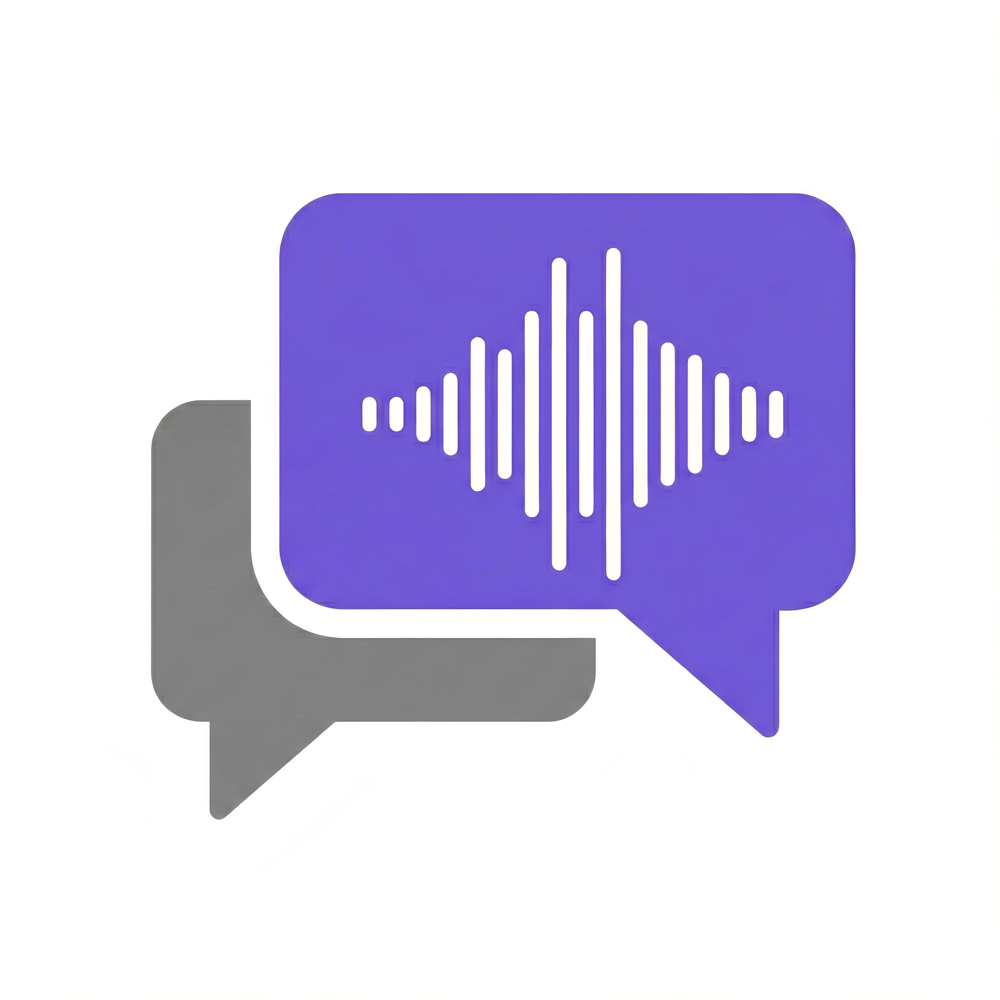

#  GibberChat

> **Whisper your secrets through the airwaves.**  
> *Secure, sound-based communication for the paranoid and the playful.*


---

## 📥 **Download**
<a href="GibberChat.apk">
  
</a>

**[Click here to download GibberChat.apk](GibberChat.apk)**

---

## 🧐 What is GibberChat?
GibberChat isn't just another messaging app. It transmits data using **audio waves**, allowing you to communicate securely between devices without relying on traditional internet protocols for the final hop. It's offline, it's futuristic, and it's cool.

## ✨ Features
*   **🔉 Audio-Data Transfer**: Send messages encoded as high-frequency audio.
*   **🛡️ Air-Gapped Security**: Perfect for short-range, offline secure communication.
*   **🔌 Cross-Device**: Talk between your Android phone and your PC (using the Python client).
*   **📱 Modern UI**: Sleek, dark-themed interface for a premium experience.

## 🚀 Getting Started

### 📱 Android
1.  **Download** the [GibberChat.apk](GibberChat.apk) from the link above.
2.  **Install** it on your Android device (you may need to enable "Install from Unknown Sources").
3.  **Grant Permissions** for the microphone (we need ears to hear the data!).

### 💻 PC Client (Python)
Want to chat from your desktop?
1.  Navigate to the `python/` folder.
2.  Install dependencies:
    ```bash
    pip install -r requirements.txt
    ```
3.  Launch the workstation:
    ```bash
    python gibberlink_gui.py
    ```

## 🏗️ Build from Source
If you're a developer and want to tinker:
```bash
cd android
./gradlew assembleDebug
```

---
*Built with ❤️ and sound waves.*
